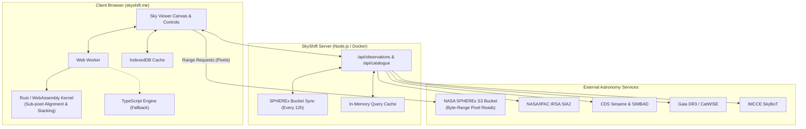

# SkyShift 🌌🔭

[](https://skyshift.me/)
[](https://irsa.ipac.caltech.edu/Missions/spherex.html)
[](https://webassembly.org/)
[](https://www.typescriptlang.org/)
[](https://azure.microsoft.com/en-us/products/container-apps)

> **High-performance, browser-first spectral sky explorer for NASA's SPHEREx mission data.**  
> Align, stack, track, and uncover moving or variable celestial objects across 102 infrared wavelengths directly in your browser.

🚀 **Explore live now at [https://skyshift.me](https://skyshift.me)**

---

## 📖 Table of Contents

- [Overview](#-overview)
- [Key Features](#-key-features)
- [Science & Discovery Tools](#-science--discovery-tools)
- [Architecture & Data Pipeline](#-architecture--data-pipeline)
- [Bundled Science Targets](#-bundled-science-targets)
- [Getting Started Locally](#-getting-started-locally)
- [Docker & Production Deployment](#-docker--production-deployment)
- [Testing & Benchmarking](#-testing--benchmarking)
- [Data Citations & Credits](#-data-citations--credits)

---

## 🌟 Overview

**SkyShift** enables astronomers, researchers, and citizen scientists to explore multi-epoch, multi-wavelength infrared data from NASA's **SPHEREx** (*Spectro-Photometer for the History of the Universe, Epoch of Reionization, and Ices Explorer*) mission.

Traditional astronomical pipelines require downloading gigabytes of FITS images and running heavy local software. SkyShift changes this by performing:
- **Zero-Footprint Streaming**: Streams only the necessary pixel sub-ranges directly from NASA's public AWS S3 bucket (`nasa-irsa-spherex`) via HTTP byte-range requests.
- **Client-Side WASM Stacking**: Microsecond sub-pixel alignment and visit co-addition executed inside a background Web Worker using a **Rust/WebAssembly** kernel (with automatic TypeScript fallback).
- **Transient & Mover Detection**: Automated statistical detection (5σ threshold) to find asteroids, high-proper-motion stars, and brown dwarfs between observation visits.

---

## ✨ Key Features

| Feature | Description |
| :--- | :--- |
| 🚀 **High-Performance Map Canvas** | Smooth pan, multi-touch pinch-to-zoom, sub-pixel rendering, coordinate graticules, and cutout boundaries. |
| ⚡ **WASM Stacking Kernel** | Rust compiled to WebAssembly aligns and co-adds multi-exposure visits in real-time inside dedicated Web Workers. |
| 📈 **Quick Spectrum Generator** | On-demand vector SVG spectrum across SPHEREx's 102 channels; measures both total flux and calibrated surface brightness ($MJy/sr$). |
| 🛸 **Automated Mover Finder** | Autonomous source detection that flags candidates moving $\ge 1$ pixel at $\ge 5\sigma$ confidence with field-calibrated astrometry. |
| 🎯 **Instant Cross-Identification** | Live astrometric matching with **CDS Sesame**, **SIMBAD**, **Gaia DR3**, **CatWISE2020**, and **IMCCE SkyBoT**. |
| 🎨 **False-Color Composites** | Dynamically synthesizes three infrared detector arrays into high-contrast RGB composites. |
| 📴 **Offline-Capable** | Bundled with 5 real target fields and client-side IndexedDB caching for offline analysis. |
| 📱 **Responsive & Embeddable** | Fully responsive touch-friendly UI for mobile and desktop; supports `embed=1` for compact iframe integration. |

---

## 🔬 Science & Discovery Tools

### 1. Find Movers (`F`)
Measures every point source in every visit. It autonomously:
- Calibrates registration offsets and centroid errors using the field's own background stars.
- Calculates straight-line proper motion across all visits.
- Flags movers with $\ge 5\sigma$ significance and $\ge 1$ pixel ($3''$) displacement.
- Configures visits **A** and **B** to the optimal temporal baseline for instant **Blink** comparison.

### 2. Track & Identify (`T` or Click)
Click any star or transient candidate to:
- Trace its path and measure brightness across every SPHEREx visit.
- Fit proper motion in arcseconds per year ($mas/yr$).
- Epoch-propagate catalog coordinates to the exact observation date.
- Query SIMBAD, Gaia DR3, and SkyBoT to classify the object (*e.g., Brown Dwarf, Known Asteroid, Mira Variable, or Unidentified Candidate*).

### 3. Interactive Quick Spectrum
Extract spectra for any arbitrary celestial position or tracked object:
- Graphs nominal channels across all **6 detector arrays** (0.75 μm to 5.0 μm).
- Toggle between total integrated flux and calibrated surface brightness ($MJy/sr$).
- Interactive hover readouts with channel wavelength and uncertainty bounds.

### 4. Comparison Star & Differential Photometry
- Select reference stars directly from the map or catalog.
- Measure flux ratios, compute differential magnitudes, and inspect FLAGS data to isolate true astrophysical variability from detector artifacts.
- Export results as structured JSON or CSV.

---

## 🏗️ Architecture & Data Pipeline



---

## 🪐 Bundled Science Targets

SkyShift includes pre-packaged real observations for 5 canonical science verification fields:

| Target ID | Object | Class / Significance | Characteristics |
| :--- | :--- | :--- | :--- |
| `wise0855` | **WISE J085510.83-071442.5** | Sub-stellar Brown Dwarf | 4th closest system to the Sun; 45 real DR1 exposures across 3 visits. |
| `barnard` | **Barnard's Star** | High Proper Motion M-dwarf | Highest known proper motion ($\sim 10.3''/yr$); epoch-corrected cutout. |
| `epsindiB` | **Epsilon Indi Ba,Bb** | Binary Brown Dwarf System | Cold substellar benchmark in Band 6. |
| `rdra` | **R Draconis** | Mira Variable | High-amplitude pulsating asymptotic giant branch (AGB) star. |
| `rwaur` | **RW Aurigae** | Young T Tauri Variable | Complex circumstellar disc and accretion variability. |

---

## 💻 Getting Started Locally

### Prerequisites
- **Node.js**: v18.0.0 or higher
- **npm**: v9.0.0 or higher
- *(Optional for WASM build)*: **Rust** with `wasm32-unknown-unknown` target. *(If Rust is not installed, the project automatically builds using the TypeScript engine).*

### Installation & Run

1. **Clone the repository:**
   ```bash
   git clone https://github.com/happinessisreal/skyshift.git
   cd skyshift
   ```

2. **Install dependencies:**
   ```bash
   npm install
   ```

3. **Build the application:**
   ```bash
   npm run build
   ```

4. **Start the local development server:**
   ```bash
   npm run dev
   ```

5. **Open your browser:**  
   Navigate to [http://127.0.0.1:4173](http://127.0.0.1:4173).

---

## 🐳 Docker & Production Deployment

### Run with Docker or Podman

The multi-stage `Dockerfile` compiles the WebAssembly kernel, builds all assets, and starts the production server:

```bash
# Build the container image
docker build -t skyshift .

# Run container on port 8080
docker run -d -p 8080:8080 --name skyshift skyshift
```
Visit `http://localhost:8080` to access the viewer.

### Deploying to Azure Container Apps

The production deployment at **[https://skyshift.me](https://skyshift.me)** runs on Azure Container Apps:
1. Automated CI/CD runs via `.github/workflows/deploy.yml` on every push to `main`.
2. Connects using GitHub Actions OpenID Connect (OIDC).
3. Auto-provisions custom domain routing with free SSL/TLS certificates using the provided scripts:
   ```bash
   bash deploy/azure-setup.sh
   bash deploy/azure-domain.sh
   ```

---

## 🧪 Testing & Benchmarking

Ensure code quality, parsing compliance, and verify performance benchmarks:

```bash
# Run unit & regression test suites (FITS, VOTable, Astrometry, Photometry)
npm test

# Benchmark Rust/WASM vs TypeScript stacking engines
npm run bench

# Rebuild offline sample targets from live archive
npm run build:examples
```

---

## 📜 Data Citations & Credits

- **SPHEREx Data**: Provided by the **NASA/IPAC Infrared Science Archive (IRSA)**.
  - Spectral Images DOI: [10.26131/IRSA678](https://doi.org/10.26131/IRSA678)
  - All-Sky Spectral Cube DOI: [10.26131/IRSA679](https://doi.org/10.26131/IRSA679)
- **Astrometry & Catalogs**:
  - European Space Agency (ESA) **Gaia DR3**
  - NASA/IPAC **CatWISE2020** & **NEOWISE**
  - Centre de Données astronomiques de Strasbourg (**CDS Sesame & SIMBAD**)
  - Institut de mécanique céleste et de calcul des éphémérides (**IMCCE SkyBoT**)

---

<p align="center">
  Developed for the <strong>NASA Space Apps Challenge</strong> • Built with ❤️ for open astrophysics.
</p>
